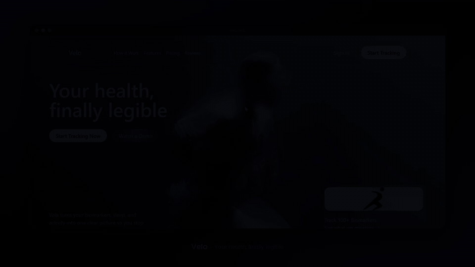

<div align="center">

# Velo

**Your health, finally legible.**

A modern, responsive landing page for a health-tracking app that turns biomarkers, sleep, and activity into one clear picture.




</div>

---
## Live Demo : 
- https://velo-healthy.netlify.app/

## Overview

Velo is a single-page marketing website built with plain HTML, Tailwind CSS . No framework, no build step beyond the Tailwind CLI.

## Sections

- **Hero**: headline, calls to action, and a "Track 100+ Biomarkers" card
- **How it works**: three-step walkthrough
- **Core features**: tabbed showcase (Connect, See, Act, Ask)
- **Reviews**: swipeable testimonial carousel with arrows and dots
- **Pricing**: Personal and Family plans
- **FAQ**: collapsible questions
- **Call to action and footer**: newsletter form and link columns

## Highlights

- Fully responsive (mobile, tablet, desktop)
- Floating pill header with a scroll-driven blur animation (`animation-timeline: scroll()`)
- Custom design tokens defined in Tailwind's `@theme`
- Reusable component classes (`btn-primary`, `btn-dark`, `btn-accent`, and more)

## Getting started

```bash
# 1. Clone
git clone https://github.com/Sondosprg/velo.git
cd velo

# 2. Install
npm install

# 3. Build the CSS and watch for changes
npx @tailwindcss/cli -i src/input.css -o src/output.css --watch 
```

Then open `index.html` in your browser (open with server)

## Author

Built by **Soundous Cherifi** ([@Sondosprg](https://github.com/Sondosprg)).

## License

This project is open source. Add a `LICENSE` file (for example MIT) to specify the terms.
